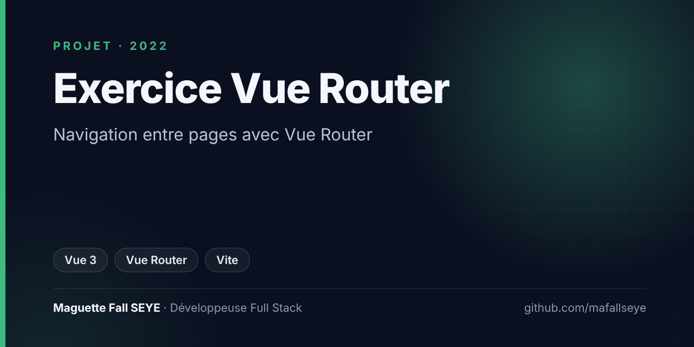

<p align="center"></p>

# Exercice Vue Router

Exercice Vue Router : navigation entre les pages Home, About et Movies.

## Fonctionnalités

- Routes Home, About et Movies
- Navigation sans rechargement de page

## Technologies

Vue 3 · Vue Router · Vite

## Lancer le projet

Prérequis : Node.js 18 ou plus.

```bash
git clone https://github.com/mafallseye/vue-router.git
cd vue-router
npm install
npm run dev
```

> Projet réalisé en 2022 pendant ma formation. Il est conservé ici comme trace de mon parcours.

## Auteure

**Maguette Fall SEYE** — Développeuse Full Stack, Dakar (Sénégal) · [github.com/mafallseye](https://github.com/mafallseye)
